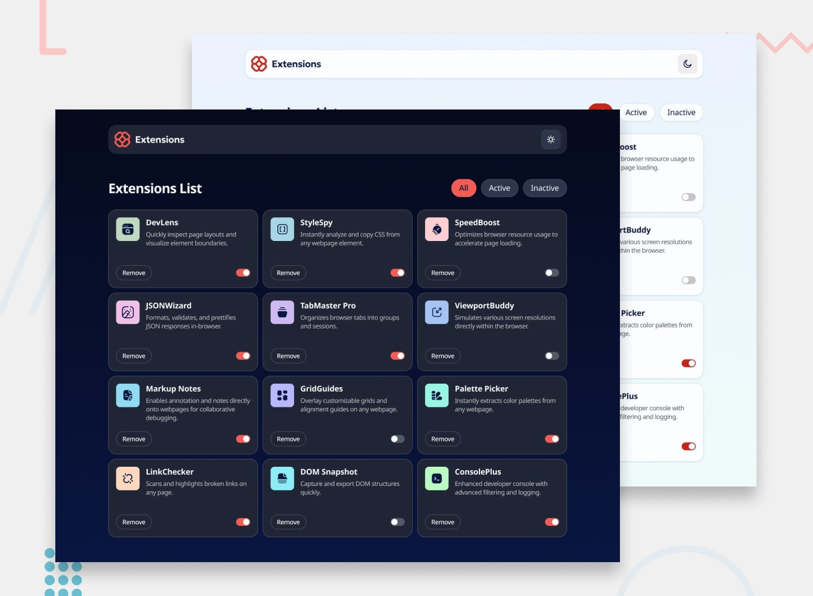

# Frontend Mentor - Browser extensions manager UI solution

This is a solution to the [Browser extensions manager UI challenge on Frontend Mentor](https://www.frontendmentor.io/challenges/browser-extension-manager-ui-yNZnOfsMAp). Frontend Mentor challenges help you improve your coding skills by building realistic projects.

## Table of contents

- [Overview](#overview)
  - [The challenge](#the-challenge)
  - [Screenshot](#screenshot)
  - [Links](#links)
- [My process](#my-process)
  - [Built with](#built-with)
  - [What I learned](#what-i-learned)
  - [Continued development](#continued-development)
  - [Useful resources](#useful-resources)
  - [AI Collaboration](#ai-collaboration)
- [Author](#author)
- [Acknowledgments](#acknowledgments)

## Overview

### The challenge

Users should be able to:

- Toggle extensions between active and inactive states
- Filter active and inactive extensions
- Remove extensions from the list
- Select their color theme
- View the optimal layout for the interface depending on their device's screen size
- See hover and focus states for all interactive elements on the page

### Screenshot



### Links

- Solution URL: [https://lenzygold5-ops.github.io/landing/](https://lenzygold5-ops.github.io/landing/)
- Live Site URL: [https://lenzygold5-ops.github.io/landing/](https://lenzygold5-ops.github.io/landing/)
- Repository: [https://github.com/lenzygold5-ops/landing](https://github.com/lenzygold5-ops/landing)

## My process

### Built with

- Semantic HTML5 markup
- CSS custom properties for theming
- CSS Grid (both for the card layout and for the extension grid)
- Flexbox for the header, card footer, and filter row
- Mobile-first workflow
- Vanilla JavaScript (no framework)
- `fetch` and the `&lt;template&gt;` element for rendering the extension list
- GitHub Pages for deployment

### What I learned

**Theming with CSS custom properties instead of class toggles.** The part I'm most happy with is how little the dark theme touches. Rather than adding a `.dark` class to components and overriding their colors one by one, I defined semantic tokens once and then re-pointed them:

```css
:root {
  --surface: hsl(0, 0%, 100%);
  --text-strong: var(--neutral-900);
  --accent: var(--red-500);
}

[data-theme='dark'] {
  --surface: var(--neutral-800);
  --text-strong: hsl(0, 0%, 100%);
  --accent: var(--red-400);
}
```

Because every component references `var(--surface)` rather than a literal color, the entire dark theme is that one block. Adding a third theme would mean adding a third block and nothing else. This is the idea I want to carry into every future project.

**Using `grid-template-areas` to change layout without changing markup.** The design indents the extension description under the title on desktop, but runs it full-width under the logo on mobile. Rather than duplicating markup or nudging things with margins, I let the same three elements (logo, name, description) be direct siblings in a grid and swapped which cells they occupy:

```css
/* Mobile: description spans the full card width */
.card__body {
  grid-template-areas:
    'logo name'
    'desc desc';
}

/* Desktop: description sits in the second column, logo spans both rows */
.card__body {
  grid-template-areas:
    'logo name'
    'logo desc';
}
```

**Event delegation for a list that re-renders.** Because every filter change or toggle rebuilds the cards, attaching a listener to each button would mean constantly discarding and re-binding them. One listener on the grid container handles all of them:

```js
grid.addEventListener('click', (event) => {
  const button = event.target.closest('button');
  if (!button) return;

  const { index } = button.closest('.card').dataset;

  if (button.classList.contains('btn--remove')) removeExtension(Number(index));
  if (button.classList.contains('switch')) toggleExtension(Number(index));
});
```

**A native `button` with `role="switch"` beats a styled checkbox.** I used `<button role="switch" aria-checked="true">` for the on/off toggles. A real checkbox can be restyled, but `appearance: none` strips its native look while leaving an awkward state model behind. This approach gets keyboard behaviour for free from the `button` element and still announces as an on/off switch rather than "checked" to screen readers.

**`fetch` and the CORS trap.** The page worked perfectly in the editor and showed nothing but an error when opened directly as a file. `fetch` is blocked by CORS on `file://` URLs, so serving the folder over HTTP (`npx serve .`) was required. Worth remembering for any future project that loads data.

### Continued development

- Replace the in-memory array with `localStorage` so extension state survives a page refresh
- Add a confirmation step before removing an extension
- Give the filter buttons a proper roving `tabindex` if I want them to behave exactly like a tablist
- Improve the empty state so removing every extension in a filter shows something more useful than a generic message
- Test the full range of screen sizes from 320px upward against WCAG requirements

### Useful resources

- [MDN Web Docs - CSS custom properties](https://developer.mozilla.org/en-US/docs/Web/CSS/--*) - the clearest explanation of the cascade behaviour that makes theming work
- [MDN Web Docs - grid-template-areas](https://developer.mozilla.org/en-US/docs/Web/CSS/grid-template-areas) - how named grid areas resolve, which finally made the responsive card layout click for me
- [MDN Web Docs - Event delegation](https://developer.mozilla.org/en-US/docs/Learn/JavaScript/Building_blocks/Events) - the `closest()` pattern I used for the card list
- [WAI-ARIA Authoring Practices - Switch pattern](https://www.w3.org/WAI/ARIA/apg/patterns/switch/) - the keyboard and screen reader behaviour behind `role="switch"`
- [WCAG Quick Reference](https://www.w3.org/WAI/WCAG22/quickref/) - contrast and focus visibility checks

### AI Collaboration

I used an AI assistant (OpenCode) while building this project, mainly as a thinking partner rather than a code generator.

- **Where it helped:** working through the semantic HTML structure, reasoning about how to make the theme switch cleanly, debugging a Remove button whose only text lived inside a visually-hidden span, and pointing out that the design implied a responsive `grid-template-areas` change I had missed on the first pass
- **What worked well:** being pushed to justify each decision before implementing it. Explaining *why* `role="switch"` beats a styled checkbox, or why the dark theme should re-point variables rather than override component styles, is what made those choices stick
- **What didn't:** the AI's first pass had several styling decisions (navy focus rings, a bordered card hover, a different grid gap) that didn't match the design files. Those were only caught by going back and measuring the design JPGs directly. The design was the source of truth, not the first generated pass
- **My own role:** reviewing every suggestion, measuring the actual designs, and writing all the final code

## Author

- Frontend Mentor - [@lenzygold5-ops](https://www.frontendmentor.io/profile/lenzygold5-ops)
- GitHub - [@lenzygold5-ops](https://github.com/lenzygold5-ops)

## Acknowledgments

Challenge design and assets by [Frontend Mentor](https://www.frontendmentor.io). Icons and the Noto Sans font are provided under the SIL Open Font License.